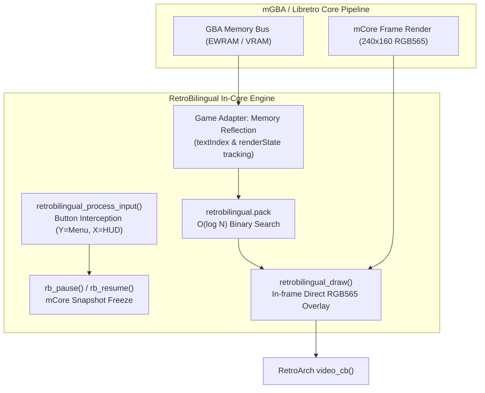

# RetroBilingual Architecture

RetroBilingual is an in-frame bilingual translation and quick-action overlay framework for retro game emulators (Libretro / GBA).

## Architectural Principles

Instead of using slow, external OCR screen scraping or rigid timeline subtitles that drift, RetroBilingual operates directly inside the emulator core's rendering and execution pipeline.



### 1. In-Core Frame Hooking
External GUI overlays on Linux handhelds compete with the emulator for `/dev/fb0` or DRM planes, leading to tearing, flickering, and frame drops. RetroBilingual hooks the core's native output buffer:
```c
/* Directly composites UI onto the 240x160 RGB565 buffer before video callback */
retrobilingual_draw(core, outputBuffer, width, height, BYTES_PER_PIXEL * 256);
videoCallback(outputBuffer, width, height, BYTES_PER_PIXEL * 256);
```

### 2. Live EWRAM Memory Reflection
In retro games, dialogue text cannot be tracked reliably by elapsed time (players read at variable speeds, dialogues repeat, branching dialogue occurs). 
RetroBilingual listens to the game's native message structure in EWRAM (`0x02000000` on GBA):
- **Dialogue ID (`textIndex`)**: Each spoken line has a unique identifier in RAM.
- **Rendering State Machine (`renderState`)**: Distinguishes between typewriter rendering, waiting for player confirmation (`[WAIT]`), and advancing to the next page.

### 3. Non-Intrusive Floating HUD
- Minimalist translucent pill background with high-contrast 1bpp bitmap font.
- No bulky modal window borders or distracting action buttons.
- Dynamic positioning (`AUTO`, `TOP`, `CENTER`, `BOTTOM`) so native text boxes are never obscured.

### 4. 5-Slot Instant Save State Management
- Independent 5-slot save state engine isolated from default emulator slots.
- Real-time disk check (`access(F_OK)`): existing slots highlighted in Green, empty slots in Gray.
- Smooth on-screen Toast feedback (`SAVED TO SLOT 1`, `LOADED SLOT 2`, `SLOT 3 IS EMPTY`).
